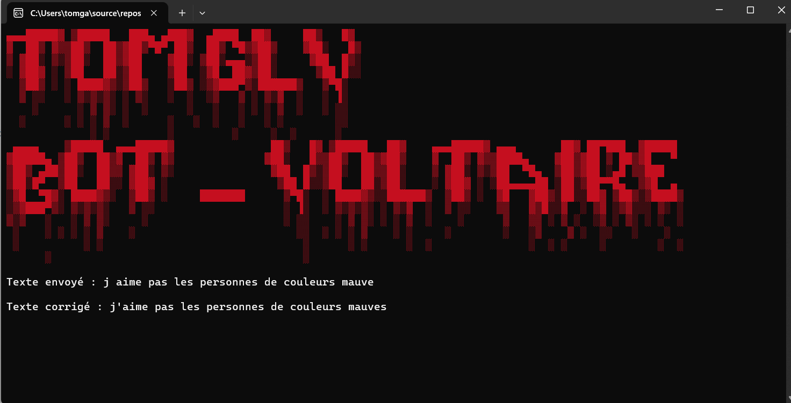

# Bot Projet Voltaire – OCR Tesseract + IA (Groq / Gemini)



Outil Windows en **C++** qui lit une phrase à l'écran avec l'**OCR Tesseract** puis la fait analyser par **deux LLM en parallèle** (GPT-OSS 120B via **Groq** et **Google Gemini**) pour repérer les fautes d'orthographe, de grammaire et de conjugaison, avec la règle associée.

## Fonctionnement

```
Capture d'une zone de l'écran (Win32 GDI)        Texte copié (Ctrl+C)
                 │                                         │
                 ▼                                         │
Prétraitement Leptonica                                    │
(niveaux de gris, agrandissement x2, contraste)            │
                 │                                         │
                 ▼                                         │
OCR Tesseract 5 (LSTM, modèle français fra.traineddata)    │
                 │                                         │
                 └──────────────► texte ◄──────────────────┘
                                   │
                 ┌─────────────────┴─────────────────┐
                 ▼                                   ▼
        Groq · GPT-OSS 120B                  Google Gemini
                 │   (requêtes HTTP parallèles,      │
                 │    libcurl + nlohmann/json)       │
                 └─────────────────┬─────────────────┘
                                   ▼
          « FAUTE : <mot> → <correction> | RÈGLE : … »
```

- Le prompt système demande une réponse courte et structurée, et d'ignorer les petites erreurs de reconnaissance de l'OCR.
- Les deux modèles sont interrogés en même temps (`std::async`) : leurs réponses se comparent d'un coup d'œil.
- Le texte est encodé correctement en UTF-8 (`CF_UNICODETEXT`, JSON généré par nlohmann/json), ce qui garde les accents.
- Les clés API ne sont jamais écrites dans le code (variables d'environnement ou `config.env`).

## Utilisation

```text
projet_voltaire.exe                   mode interactif
projet_voltaire.exe --image capture.png   OCR d'une image puis analyse IA
projet_voltaire.exe --ocr capture.png     OCR seul
projet_voltaire.exe --text "Les enfants que j'ai vu jouer..."   analyse IA d'un texte
```

En mode interactif (touches globales) :

| Touche | Action |
|---|---|
| **F7** | coin haut-gauche de la zone à lire (position de la souris) |
| **F8** | coin bas-droite de la zone |
| **F9** | capture de la zone → OCR → analyse IA |
| **Ctrl+C** sur un texte | analyse directe du texte copié |
| **Échap** | quitter (console au premier plan) |

## Installation

1. **Dépendances** avec [vcpkg](https://github.com/microsoft/vcpkg) (intégration MSBuild : `vcpkg integrate install`) :
   ```bash
   vcpkg install tesseract:x64-windows-static curl:x64-windows-static nlohmann-json:x64-windows-static
   ```
2. Ouvre `porjet_voltaire.sln` dans **Visual Studio** et compile en **Release | x64** (toolset v145, C++17, runtime statique `/MT`) : on obtient un seul `.exe` autonome.
3. Télécharge le modèle français [`fra.traineddata`](https://github.com/tesseract-ocr/tessdata_best/raw/main/fra.traineddata) et place-le à côté de l'exécutable (ou dans un dossier `tessdata/`).
4. Copie `config.env.example` en `config.env` à côté de l'exécutable et renseigne `GROQ_API_KEY` et/ou `GEMINI_API_KEY`.

Les modèles sont configurables (`GROQ_MODEL`, `GEMINI_MODEL`, `OCR_LANG`) sans recompiler.

## Historique

- **v1** : surveillance du presse-papiers et correction via l'API Reverso.
- **v2** : pipeline OCR Tesseract embarqué + analyse par LLM (Groq / Gemini), zone de capture, mode ligne de commande.

## Avertissement

Projet personnel et éducatif pour s'entraîner à l'orthographe : les réponses des LLM peuvent être fausses, vérifie toujours la règle donnée.
