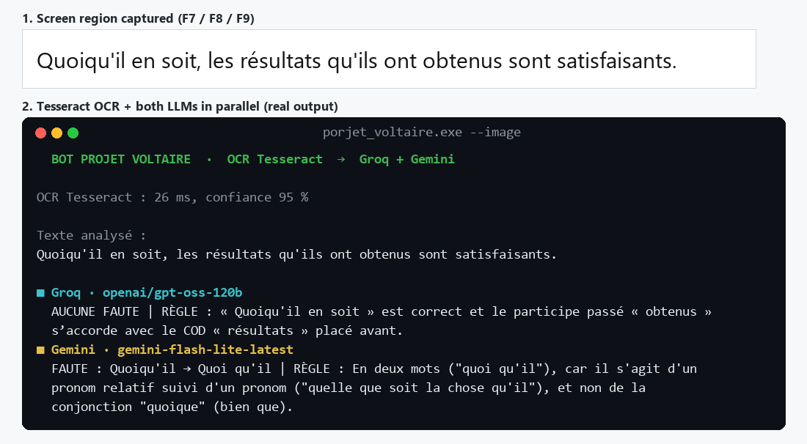

# Projet Voltaire Bot – Tesseract OCR + LLM (Groq / Gemini)


A Windows tool written in **C++** that reads a French sentence on screen with **Tesseract OCR**. It sends the text to **two LLMs in parallel**, **Groq** (GPT-OSS 120B) and **Google Gemini**, which detect spelling, grammar and conjugation mistakes and explain the rule. It is built to practise for the [Projet Voltaire](https://www.projet-voltaire.fr/) French spelling certification.



*Real output: both models answer side by side. In this example Gemini catches the mistake (« quoi qu'il » in two words) while GPT-OSS misses it, which is why the tool asks two models.*

## How it works

```
 Screen region (Win32 GDI)                 Copied text (Ctrl+C)
            │                                      │
            ▼                                      │
 Leptonica pre-processing                          │
 (grayscale, 2× upscale, contrast normalization)   │
            │                                      │
            ▼                                      │
 Tesseract 5 OCR (LSTM, French model)              │
            │                                      │
            └──────────────► text ◄────────────────┘
                              │
            ┌─────────────────┴─────────────────┐
            ▼                                   ▼
   Groq · GPT-OSS 120B                   Google Gemini
            │    parallel HTTPS requests        │
            │    (libcurl + nlohmann/json)      │
            └─────────────────┬─────────────────┘
                              ▼
       "FAUTE : <word> → <fix> | RÈGLE : <rule>"
```

- **OCR pipeline**: GDI screen capture → Leptonica image → pre-processing → `TessBaseAPI` (LSTM engine, single-block page segmentation). The OCR confidence score is displayed with each result.
- **Prompting**: the system prompt asks for a short, structured answer and tells the model to ignore small OCR recognition errors.
- **Two models, one request**: Groq and Gemini are called at the same time with `std::async`. Requests that fail with 429 or 503 are retried with backoff.
- **Unicode**: the clipboard is read as `CF_UNICODETEXT` and the JSON is built with nlohmann/json, so French accents survive the whole pipeline.
- **No secrets in code**: API keys are read from environment variables or from a git-ignored `config.env` file.
- **Single executable**: Tesseract, Leptonica, libcurl and OpenSSL are statically linked through vcpkg (`x64-windows-static`, `/MT`).

## Usage

```text
porjet_voltaire.exe                         interactive mode (screen region + clipboard)
porjet_voltaire.exe --image capture.png     OCR an image, then analyse it with the LLMs
porjet_voltaire.exe --ocr capture.png       OCR only (prints text + confidence)
porjet_voltaire.exe --text "Les fleurs que j'ai cueilli..."   analyse a text directly
```

Interactive mode (global hotkeys):

| Key | Action |
|---|---|
| **F7** | top-left corner of the region to read (mouse position) |
| **F8** | bottom-right corner of the region |
| **F9** | capture the region → OCR → LLM analysis |
| **Ctrl+C** on any text | analyse the copied text |
| **Esc** | quit (console in foreground) |

## Setup

Build the executable (see [Building from source](#building-from-source)), then next to it create a `config.env` file based on [`config.env.example`](config.env.example):

```ini
GROQ_API_KEY=...      # https://console.groq.com/keys
GEMINI_API_KEY=...    # https://aistudio.google.com/apikey
# Optional
GROQ_MODEL=openai/gpt-oss-120b
GEMINI_MODEL=gemini-flash-lite-latest
OCR_LANG=fra
```

You can change models without recompiling. One key is enough: the other model is simply skipped.

## Building from source

1. Install the dependencies with [vcpkg](https://github.com/microsoft/vcpkg) and enable its MSBuild integration:
   ```bash
   vcpkg install tesseract:x64-windows-static curl:x64-windows-static nlohmann-json:x64-windows-static
   vcpkg integrate install
   ```
2. Open `porjet_voltaire.sln` in **Visual Studio** and build **Release | x64** (toolset v145, C++17, `/utf-8`).
3. Download the French model [`fra.traineddata`](https://github.com/tesseract-ocr/tessdata_best/raw/main/fra.traineddata) and put it next to the executable, or in a `tessdata/` folder.

## Project history

- **v1**: watched the clipboard and sent the text to the Reverso spell-checking API.
- **v2**: embedded Tesseract OCR with screen-region capture, analysis by two LLMs (Groq and Gemini), command-line modes and configuration through `config.env`.

## Disclaimer

This is a personal, educational project for practising French spelling. LLM answers can be wrong, as the demo above shows, so always check the rule they give.
